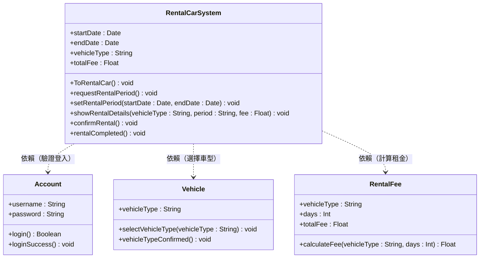

# CD_01 車輛租用系統 — Class Diagram

---

## 補充說明

| Class 名稱 | 中文名稱 | 職責說明 |
|------------|----------|----------|
| Account | 帳號管理 | 負責租車用戶的帳號註冊、登入驗證流程 |
| RentalCarSystem | 租用系統 | 負責車輛租用的領域邏輯，包含車型選擇、租用時間區間設定、租用確認等流程控制 |
| Vehicle | 車輛管理 | 負責車輛資訊管理，包含車型選擇與確認（轎車、休旅車、貨車、跑車、電動車） |
| RentalFee | 租金計算 | 負責租金相關邏輯，依車型日租金乘以租用天數計算總費用 |

---

## 設計原則遵循說明

本 Class Diagram 遵循以下設計原則：

1. ✅ **帳號管理**：所有申請帳號相關功能由 `Account` 類別負責
2. ✅ **租用系統**：租用車輛的領域邏輯由 `RentalCarSystem` 類別負責
3. ✅ **租金計算**：租金相關邏輯由獨立類別 `RentalFee` 負責
4. ✅ **車輛管理**：車輛資訊由 `Vehicle` 類別表達

---

## UML 關係說明

- **Dependency（依賴）`..>`**：表示 RentalCarSystem 在執行租用流程時會呼叫其他類別的方法，但不持有這些類別的實例作為屬性
  - RentalCarSystem 呼叫 Account.login() 驗證用戶身份
  - RentalCarSystem 呼叫 Vehicle.selectVehicleType() 選擇車型
  - RentalCarSystem 呼叫 RentalFee.calculateFee() 計算租金
