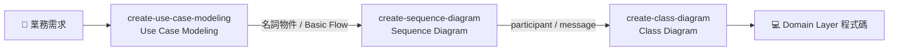
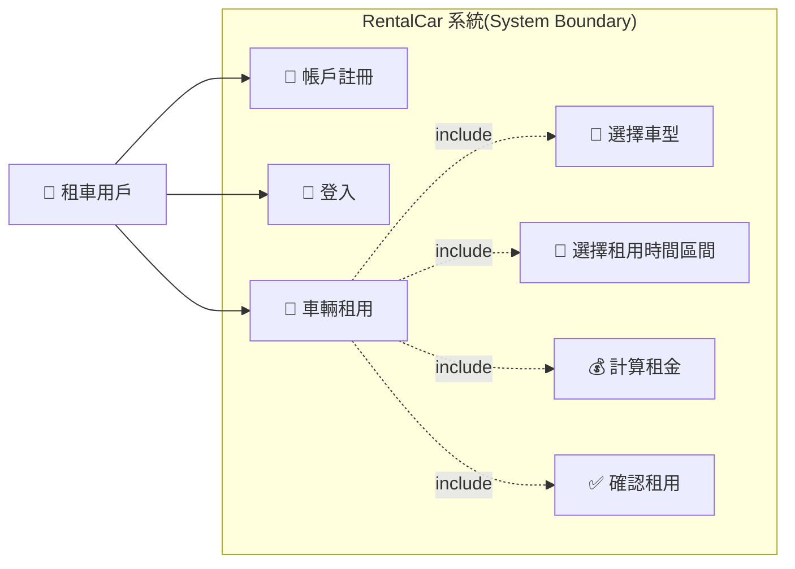
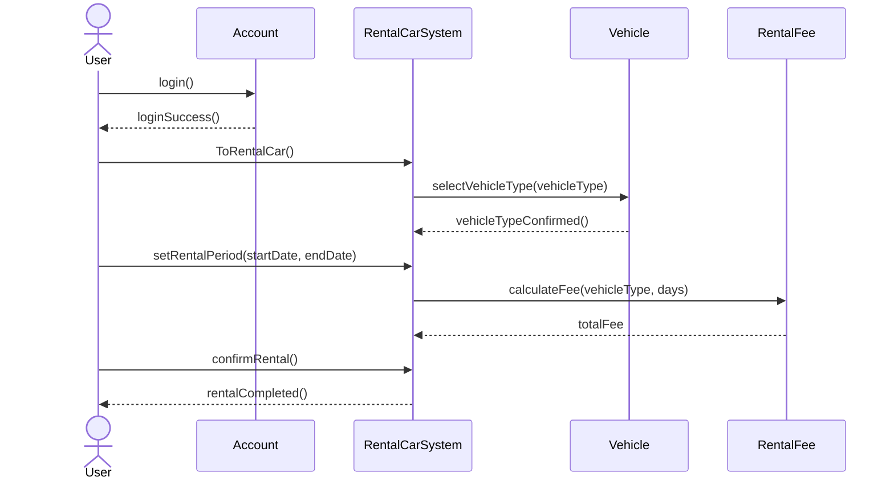
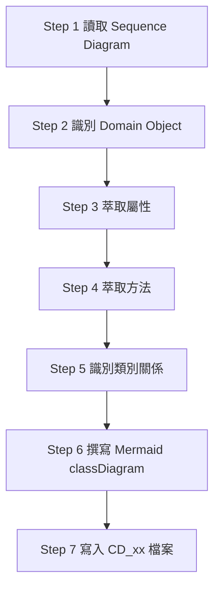

# Agent Skills 是怎麼設計出來的？從 OOAD 與 S.O.L.I.D. 到 UML 建模 Skills

> 在「讓 Agent Skills 介入你的軟體開發工作流」的分享中，我只展示了結果，沒有說明這些 Skills 是怎麼設計出來的。這篇文章補上設計過程。

## 前言

有朋友回饋，這場分享前半段說明了 AI 如何驅動以 SDLC 為基礎的規格分析與建模流程。最後的 Live Demo 只展示了成品，也就是最終的 Skills 與 Commands，沒有交代設計它們的過程。

Live Demo 用到的有：

- Commands：`sdlc-use-uml-command`、`sdlc-generate-domain-layer`、`run-command-generator`
- Skills：`create-use-case-modeling`、`create-sequence-diagram`、`create-class-diagram`

這套 Skills 的方法論來自兩個部分：

1. 我在「決戰 OOAD」系列課程中累積的分析與設計規則。
2. S.O.L.I.D. 原則，特別是單一職責原則（SRP）。

這篇以本示範專案（RentalCar 線上預先車輛租用系統）為例，說明這些規則如何變成 Skills。

---

## 一、整體思路：三個 Skills 接成一條建模鏈



三個 Skills 是上下游關係，前一個的產出是後一個的輸入：

| 階段 | Skill | 輸入 | 輸出（本專案） |
|------|-------|------|----------------|
| 1 | `create-use-case-modeling` | 業務流程 | [UC_01_車輛租用系統.md](./UC_01_車輛租用系統.md) |
| 2 | `create-sequence-diagram` | Use Case 中的領域物件與流程 | [SD_01_車輛租用系統.md](./SD_01_車輛租用系統.md) |
| 3 | `create-class-diagram` | Sequence Diagram | [CD_01_車輛租用系統.md](./CD_01_車輛租用系統.md) |

**上游品質決定下游品質。** 如果 Use Case 的邊界畫不好，Sequence 就會失焦，Class Diagram 也會跟著失真。所以我先確立每個階段的規則，再把規則寫成 Skill。

---

## 二、Use Case Skill：Modeling，而不只是 Diagram

### 為什麼說 Modeling

我盡量用 **modeling** 取代 **diagram**，因為 Use Case 不只是一張圖。圖只是呈現方式，核心是背後的分析過程與文字說明（Basic Flow 等）。

### 方法論

Use Case 的設計基於 **Basic Flow** 原則，並搭配**需求與名詞分析法**：

1. **需求與名詞分析**：從需求中找出名詞，這些名詞後續會成為領域物件。
2. **專注主要 Context**：每次只處理一個主要情境。
3. **一個 Context 代表一件事情**：Use Case 的粒度要明確。
4. **一件事情只有一組 (In / Out) → (Actor)**：一個 Use Case 對應一個 Actor 的一組輸入與輸出。
5. **其他外在干涉系統操作的行為，都屬於 Boundary 的界定**：這也是 Use Case Modeling 的最高準則，也就是界定 Boundary。

### 與 SRP 的關係

這套規則與 S.O.L.I.D. 的 SRP 有直接關聯，也就是「**一個模組應該只對一個角色負責**」。

以租車系統為例：

- Use Case 這一側：**顧客**（Actor）使用「可以租用車輛」，它包含 `選擇車型`、`選擇租用時間`、`計算租金`。
- 程式設計這一側：顧客對應到一個 `RentalService`（`<<Aggregate Root>>`），內含 `GetVehicleType()`、`ChoiseRentalTime(start, end)` 等行為，並關聯 `Car`（`<<Entity>>`）。

也就是說，**一個 Actor 對應一個 Use Case，Use Case 對應一個負責的模組（Aggregate Root）。** 這個對應關係在分析階段就確定，後面寫程式時不用再臨時猜責任歸屬。

### Mermaid 繪製準則

在 OMG UML 規範的基礎上，我另外訂定了團隊習慣與易讀性的規則，並以 Mermaid 呈現。這些規則寫在 [create-use-case-modeling/SKILL.md](./.github/skills/create-use-case-modeling/SKILL.md)：

- 使用 `flowchart LR`，由左至右呈現。
- 圖中清楚標註 Actor 與 Use Case 名稱。
- 盡可能遵循 OMG UML 規範；表達「包含」時，明確標示 include。
- Mermaid 中的 include **不用** `<<include>>`，改用 `-.->`，並在箭頭上註明 `include`。
- `subgraph` 名稱後面加上 `["XXXXXXX系統(System Boundary)"]`，明確表達系統邊界。
- 允許在 Use Case 中使用特殊字元（emoji）作為 ICON，方便閱讀。
- 圖形最下方要有 `## Use Case 說明`，因為 Use Case 不只是圖。

### 本專案的成果



---

## 三、Sequence Skill：接續 Use Case 的輕量版互動

### 設計重點

1. **Sequence 必須接續 Use Case 設計。** 不好的 Use Case 會直接影響後續 Sequence 的品質。
2. **輕量版 Sequence**：可以用多張 Sequence 表達一個 Use Case，但**每一張 Sequence 只精準表達一個 Context 的 message 範圍**。
3. **Sequence 是 Class Diagram 的基礎。**
4. **Sequence 中的 Domain Object，就是 Use Case Modeling 中出現的名詞物件**（領域物件）。

### 補充：幾種「Class」不一樣

Class 相關的產出其實不只一種，包括 Domain Class Diagram、Class Modeling、Class Diagram，它們的視角不同。這裡說的 **Domain Class** 是以**領域物件為視角**，也就是從 Basic Flow 的視角，找出與目前 Context 有關的名詞物件。這些物件互動，完成 Actor 的一系列行為，而且這些行為**不能跳出目前的 Boundary**。

### 繪製規則

規則寫在 [create-sequence-diagram/SKILL.md](./.github/skills/create-sequence-diagram/SKILL.md)：

- message 傳遞的名稱使用**英文**，中文用 `Note right` 說明。
- 領域物件依照 message 呼叫順序，**由左向右**排列。
- 依 OMG UML 規範，以 Use Case Diagram 中實際出現的**領域物件**作為 Sequence 的 Domain Object。
- Domain Object 名稱使用英文，中文用 `Note right` 說明。
- 以 ` ```mermaid ` 包裹後，直接寫入目前的檔案。

### 本專案的成果（節錄）



完整版本請見 [SD_01_車輛租用系統.md](./SD_01_車輛租用系統.md)。

---

## 四、Class Modeling / Diagram Skill：讀取上游並遵守規範

這是三個 Skills 中規範最多的一個。它必須**讀取 Use Case 與 Sequence**，再依規則建模。規則寫在 [create-class-diagram/SKILL.md](./.github/skills/create-class-diagram/SKILL.md)，包括：

- **如何識別 Domain Object？** 所有 `participant` 都納入；`actor` 是外部角色，不建模為 Class。
- **每一個 Class 的來源都必須是真實存在的 Domain Object 與 message 傳遞**，不能憑空新增。
- **屬性萃取**：從 message 的輸入參數與回傳值推斷；中文 Note 只輔助語意判斷。
- **方法萃取**：目標 participant 接收的同步呼叫，就是該 Class 的方法。
- **類別關係識別**：依 OMG UML 區分關聯、依賴、聚合、組合、實現，並有明確判斷條件。
- **命名與格式規範**：Class 用 PascalCase，屬性與方法用 camelCase；關係標籤用中文說明。
- **輸出規範**：圖形下方附補充說明表，並與 `SD_xx` 對應成 `CD_xx`。

Skill 的流程分成 7 個步驟：



在本專案，還搭配 [rental-car-class-diagram.prompt.md](./.github/prompts/rental-car-class-diagram.prompt.md) 指定四個強制設計原則：

1. 帳號管理由 `Account` 負責。
2. 租用領域邏輯由 `RentalCarSystem` 負責。
3. 租金計算由獨立的 `RentalFee` 負責。
4. 車輛資訊由 `Vehicle` 表達。

這也是 SRP 的具體應用：每個類別只負責一件事。

---

## 五、與開發工作流的整合

除了三個 Skills，本專案還有其他 Copilot 客製化檔案，讓建模結果能往下落地：

| 類型 | 檔案 | 用途 |
|------|------|------|
| 全域指引 | [copilot-instructions.md](./.github/copilot-instructions.md) | 規範 Hexagonal Architecture 與四個專案（Domain / Application / Infrastructure / Web）的分層 |
| Agent | [rentalcar-business.agent.md](./.github/agents/rentalcar-business.agent.md) | 業務需求分析師，負責需求描述與繪製 UML 圖 |
| Agent | [dotnet-developer.agent.md](./.github/agents/dotnet-developer.agent.md) | .NET 架構開發者，負責實作 |
| Prompt | [rental-car-class-diagram.prompt.md](./.github/prompts/rental-car-class-diagram.prompt.md) | 類別圖生成的設計原則 |
| Skills | `create-use-case-modeling`、`create-sequence-diagram`、`create-class-diagram` | UML 建模三部曲 |

實作成果位於 [src/](./src)，包含 `RentalCar.Domain`、`RentalCar.Application`、`RentalCar.Infrastructure`、`RentalCar.Web` 四個專案。

---

## 六、本示範專案的限制

- Use Case 有「帳戶註冊」，但 SD 與 CD 還沒有對應的註冊流程。
- CD 把 SD 中 `User` 的回呼方法（如 `loginSuccess`）也放進了類別，與 Skill 的規則不完全吻合。
- 以 SRP 來看，目前的 UC / SD / CD 還可以再依 Context 拆分，讓每一張圖只對應一個 Actor 的一件事。

這些是示範專案的現況，也說明 Skill 需要持續迭代：用成果檢驗規則，再把規則修回 Skill。

---

## 結語

這些流程是在有 AI 之後的這幾年慢慢發展出來的。我大部分是在客戶端擔任顧問時，直接與客戶一起協作、邊做邊調整，比較少整理成文章。

目前比較完整的代表課程，是**《AI 時代下的系統分析與設計的七堂課》**。

如果想了解更多細節，我建議直接閱讀實際的 Skill 內容：

- [create-use-case-modeling/SKILL.md](./.github/skills/create-use-case-modeling/SKILL.md)
- [create-sequence-diagram/SKILL.md](./.github/skills/create-sequence-diagram/SKILL.md)
- [create-class-diagram/SKILL.md](./.github/skills/create-class-diagram/SKILL.md)
