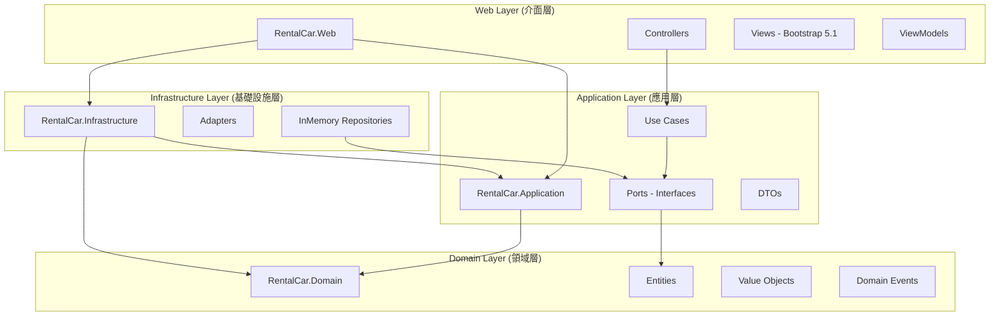

# RentalCar 專案架構說明

## 🏛️ 架構層次圖



## 📦 專案結構詳解

### 1. RentalCar.Domain（領域層）

**職責**：純粹的業務邏輯，不依賴任何外部框架

```
RentalCar.Domain/
├── Entities/
│   ├── Account.cs              # 帳號實體
│   ├── Rental.cs               # 租用實體
│   └── Vehicle.cs              # 車輛實體
├── ValueObjects/
│   ├── VehicleType.cs          # 車型值物件
│   ├── RentalPeriod.cs         # 租用期間值物件
│   └── Money.cs                # 金額值物件
└── Exceptions/
    └── DomainException.cs      # 領域例外
```

**特點**：
- ✅ 使用 Value Object 封裝領域概念
- ✅ Entity 使用靜態工廠方法保證不變式
- ✅ 無任何基礎設施相依（純 C# BCL）
- ✅ 高內聚、低耦合

### 2. RentalCar.Application（應用層）

**職責**：定義 Use Cases 與系統介面（Ports）

```
RentalCar.Application/
├── Abstractions/
│   ├── ICommand.cs             # Command 介面
│   ├── ICommandHandler.cs      # Handler 介面
│   └── Repositories/
│       ├── IAccountRepository.cs    # 帳號 Port
│       └── IRentalRepository.cs     # 租用 Port
├── UseCases/
│   ├── Accounts/
│   │   ├── Register/
│   │   │   ├── RegisterAccountCommand.cs
│   │   │   └── RegisterAccountCommandHandler.cs
│   │   └── Login/
│   │       ├── LoginCommand.cs
│   │       └── LoginCommandHandler.cs
│   └── Rentals/
│       └── Create/
│           ├── CreateRentalCommand.cs
│           └── CreateRentalCommandHandler.cs
└── DTOs/
    └── VehicleTypeDto.cs       # 資料傳輸物件
```

**特點**：
- ✅ CQRS 模式（Command/Query 分離）
- ✅ 定義清晰的 Ports（介面）
- ✅ 只依賴 Domain 層
- ✅ 職責單一，易於測試

### 3. RentalCar.Infrastructure（基礎設施層）

**職責**：實作 Application 定義的介面（Adapters）

```
RentalCar.Infrastructure/
└── Repositories/
    ├── InMemoryAccountRepository.cs    # 帳號 Adapter
    └── InMemoryRentalRepository.cs     # 租用 Adapter
```

**特點**：
- ✅ 實作 Application 層定義的 Ports
- ✅ 使用 InMemory 儲存（便於測試）
- ✅ 可輕鬆替換為 EF Core / Dapper
- ✅ 不洩漏實作細節到其他層

### 4. RentalCar.Web（介面層 / Composition Root）

**職責**：API/UI、DI 組態、輸入驗證、例外處理

```
RentalCar.Web/
├── Controllers/
│   ├── HomeController.cs       # 首頁控制器
│   ├── AccountController.cs    # 帳號控制器
│   └── RentalController.cs     # 租用控制器
├── Views/
│   ├── Shared/
│   │   ├── _Layout.cshtml      # 主版面配置
│   │   └── _ValidationScriptsPartial.cshtml
│   ├── Home/
│   │   └── Index.cshtml        # 首頁
│   ├── Account/
│   │   ├── Register.cshtml     # 註冊頁面
│   │   └── Login.cshtml        # 登入頁面
│   └── Rental/
│       ├── Index.cshtml        # 租車頁面
│       └── Success.cshtml      # 成功頁面
├── Models/
│   ├── RegisterViewModel.cs
│   ├── LoginViewModel.cs
│   └── CreateRentalViewModel.cs
├── Program.cs                  # DI 組態與啟動
└── appsettings.json            # 設定檔
```

**特點**：
- ✅ 使用 Bootstrap 5.1 響應式設計
- ✅ Session 管理（記憶體快取）
- ✅ DI 綁定 Ports → Adapters
- ✅ 輸入驗證與錯誤處理

## 🔄 依賴方向

```
┌─────────────────────────────────────────┐
│         Web Layer (介面層)               │
│  Controllers / Views / ViewModels       │
│  - DI 組態                              │
│  - 輸入驗證                              │
│  - Session 管理                          │
└─────────┬───────────────────────────────┘
          │ 依賴
          ↓
┌─────────────────────────────────────────┐
│    Application Layer (應用層)            │
│  Use Cases / Commands / Ports           │
│  - 業務流程協調                          │
│  - 定義介面（Ports）                     │
└─────────┬───────────────────────────────┘
          │ 依賴
          ↓
┌─────────────────────────────────────────┐
│      Domain Layer (領域層)               │
│  Entities / Value Objects / Events      │
│  - 純粹業務邏輯                          │
│  - 不依賴任何框架                         │
└─────────────────────────────────────────┘
          ↑
          │ 實作介面
┌─────────┴───────────────────────────────┐
│  Infrastructure Layer (基礎設施層)       │
│  Repositories / Adapters / Services     │
│  - 實作 Ports（Adapters）                │
│  - InMemory / 資料存取                   │
└─────────────────────────────────────────┘
```

## 🎯 核心設計原則

### SOLID 原則
- **S** - Single Responsibility：每個類別單一職責
- **O** - Open/Closed：對擴展開放，對修改封閉
- **L** - Liskov Substitution：子類別可替換父類別
- **I** - Interface Segregation：介面隔離，客戶端不依賴不需要的介面
- **D** - Dependency Inversion：依賴抽象而非具體實作

### Hexagonal Architecture 原則
- **Ports**：在 Application 層定義介面
- **Adapters**：在 Infrastructure 層實作介面
- **依賴反轉**：Domain 與 Application 不依賴基礎設施
- **可測試性**：核心邏輯可獨立測試

### Clean Architecture 原則
- **依賴規則**：依賴只能由外向內
- **獨立性**：Domain 完全獨立於框架
- **可測試性**：業務邏輯可獨立測試
- **UI 獨立**：UI 可輕鬆替換

## 📊 業務流程範例

### 租車流程（CreateRental）

```
1. 用戶提交表單 (Web)
   ↓
2. Controller 驗證輸入 (Web)
   ↓
3. 建立 CreateRentalCommand (Application)
   ↓
4. Handler 處理指令 (Application)
   ├─ 驗證帳號存在 (透過 IAccountRepository Port)
   ├─ 建立 Rental Entity (Domain)
   ├─ 選擇車型 (Domain)
   ├─ 設定期間 (Domain)
   ├─ 計算租金 (Domain)
   └─ 確認租用 (Domain)
   ↓
5. 儲存 Rental (透過 IRentalRepository Port)
   ↓
6. InMemoryRentalRepository 儲存 (Infrastructure)
   ↓
7. 返回結果給 Controller (Web)
   ↓
8. 顯示成功頁面 (Web)
```

## 🧪 測試策略

### Domain Layer 測試
- 純單元測試（無 Mock）
- 測試商業規則與不變式
- 測試 Value Object 行為

### Application Layer 測試
- 使用 Mock Repository
- 測試 Use Case 邏輯
- 測試 Command Handler

### Infrastructure Layer 測試
- 整合測試（如使用真實資料庫）
- 測試 Repository 實作

### Web Layer 測試
- API 整合測試（WebApplicationFactory）
- UI 測試（Selenium / Playwright）

## 🚀 擴展方向

### 1. 替換資料儲存
```csharp
// 從 InMemory 替換為 EF Core
services.AddScoped<IAccountRepository, EfAccountRepository>();
services.AddScoped<IRentalRepository, EfRentalRepository>();
```

### 2. 加入驗證
```csharp
// 使用 FluentValidation
services.AddValidatorsFromAssembly(typeof(CreateRentalCommand).Assembly);
```

### 3. 加入 Domain Events
```csharp
public sealed class RentalConfirmed : IDomainEvent
{
    public Guid RentalId { get; }
    public DateTime OccurredAt { get; }
}
```

### 4. 實作 CQRS 讀寫分離
```csharp
// Query Side
public interface IRentalQueryService
{
    Task<RentalDto> GetRentalByIdAsync(Guid rentalId);
    Task<IReadOnlyList<RentalDto>> GetRentalsByAccountAsync(Guid accountId);
}
```

---

**設計哲學**：簡單、清晰、可維護、可測試  
**架構目標**：業務邏輯與技術細節分離，便於長期演進
